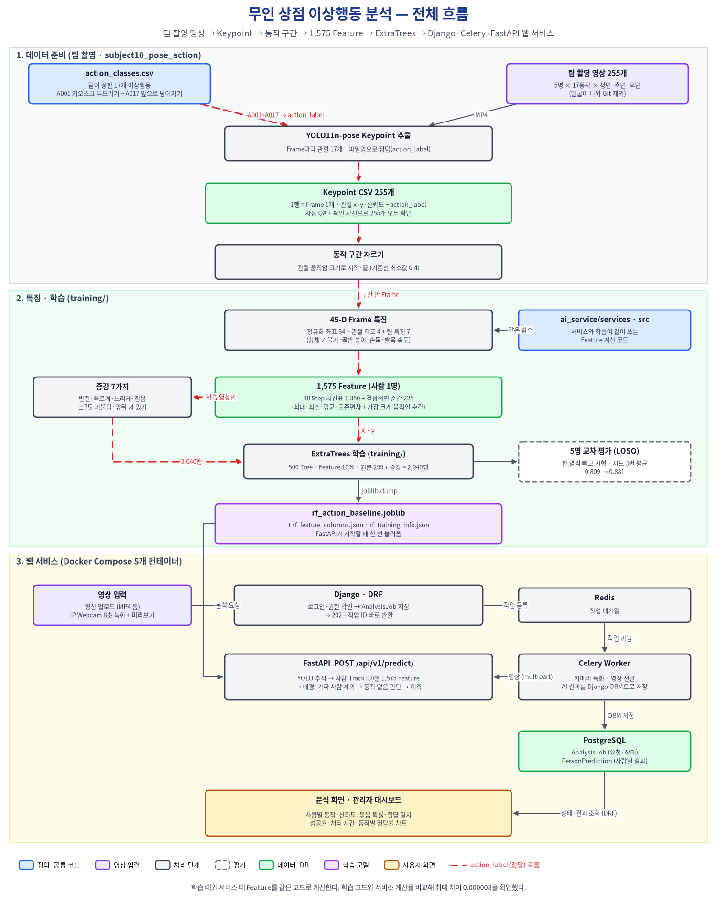
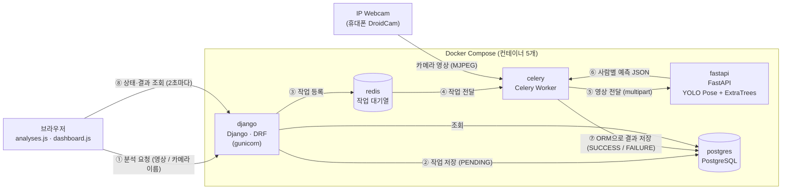
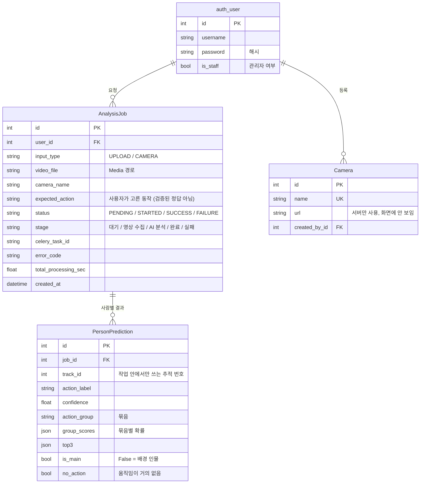
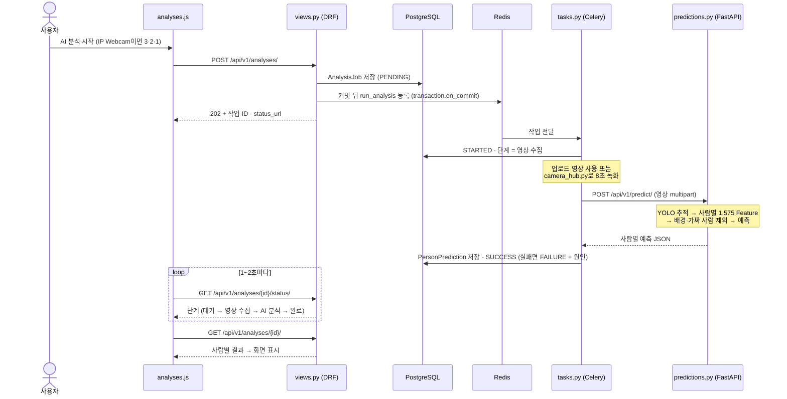
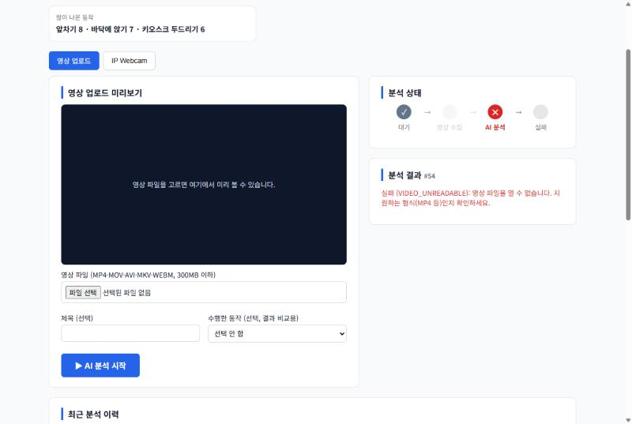
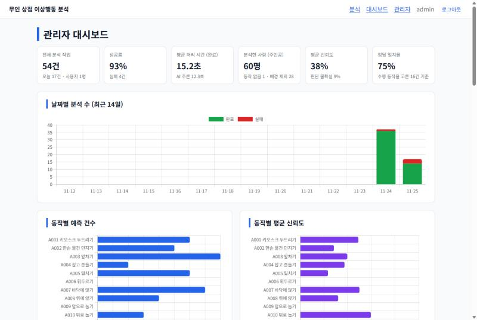
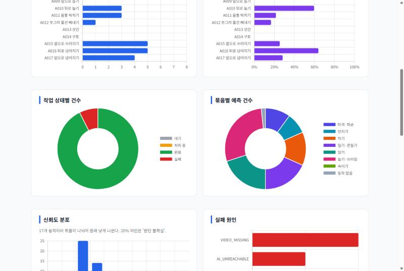
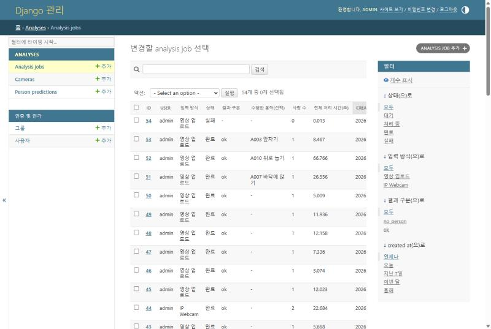
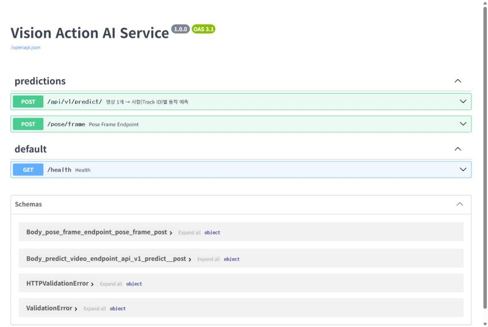

# 무인 상점 이상행동 분석 서비스

팀이 직접 촬영·라벨링한 **17개 이상행동** 영상으로 동작 인식 모델을 만들고, 영상을 올리거나 IP Webcam으로 찍으면 사람마다 어떤 동작을 했는지 알려 주는 웹 서비스입니다.



| 항목 | 내용 |
|---|---|
| 동작 | 17개 이상행동 (두드리기·던지기·차기·밀치기·흔들기·앉기·눕기·넘어지기·구토 등) |
| 입력 | 영상 업로드(MP4·MOV·AVI·MKV·WEBM) · IP Webcam 8초 녹화 |
| 결과 | 사람(Track ID)별 동작 · 신뢰도 · 묶음 확률 · 후보 3개, 관리자 대시보드 |
| 모델 성능 | 처음 보는 사람 기준 정확도 **0.881** (5명 교차 평가, 시드 3번 평균) |
| 구성 | Django·DRF · Celery · Redis · FastAPI · PostgreSQL — Docker Compose 컨테이너 5개 |

---

## 1. 프로젝트 소개

무인 상점에서 키오스크를 내려치거나, 기계를 흔들거나, 사람이 쓰러지는 장면을 영상으로 찾아내는 서비스입니다. 사용자는 **영상 파일을 올리거나**, 휴대폰을 **IP Webcam**으로 연결해 미리보기 화면을 보면서 8초를 녹화해 분석을 맡깁니다. 결과로 영상 속 **사람마다** 가장 가까운 동작과 신뢰도, 같은 계열 동작을 묶은 확률, 후보 3개를 확인하고, 관리자는 전체 분석 기록과 정확도를 대시보드로 봅니다.

모델은 팀원 5명이 17개 동작을 정면·측면·후면에서 찍은 영상 255개로 학습했습니다 (교재의 6개 일상 동작 대신 팀이 정한 무인 상점 이상행동을 사용).

## 2. 실행 방법

필요한 것: Docker Desktop (Compose v2)

```bash
git clone https://github.com/ariuck/vision_action_platform.git
cd vision_action_platform
cp .env.example .env          # DJANGO_SECRET_KEY, POSTGRES_PASSWORD 값을 바꾼다
docker compose up --build -d  # 컨테이너 5개 실행 (마이그레이션은 django 컨테이너가 시작할 때 자동 적용)
docker compose exec django python manage.py createsuperuser   # 관리자 계정
```

- 모델 파일은 `ai_service/models/`에 들어 있습니다 (`rf_action_baseline.joblib`, `rf_feature_columns.json`, `rf_training_info.json`, `yolo11n-pose.pt`). FastAPI 컨테이너가 이 폴더를 읽기 전용으로 연결합니다.
- IP Webcam을 쓰려면 `.env`의 `ALLOWED_CAMERAS=이름=http://<휴대폰IP>:4747/video`에 등록하거나, 분석 화면의 **+ 카메라 추가**에서 같은 Wi-Fi 대역(기본 192.168.x.x) 주소를 등록합니다.
- 컨테이너는 GPU 없이 CPU로 추론합니다 (영상 1개에 약 5~20초).

| 화면 | 주소 |
|---|---|
| 사용자 분석 화면 | http://localhost:8000/analyses/ |
| 회원가입 · 로그인 | http://localhost:8000/accounts/signup/ · /accounts/login/ |
| 관리자 대시보드 | http://localhost:8000/dashboard/ |
| Django Admin | http://localhost:8000/admin/ |
| 분석 API | http://localhost:8000/api/v1/analyses/ |
| FastAPI Swagger | http://localhost:8001/docs |

## 3. 전체 아키텍처



- **Django·DRF**: 회원·권한, 분석 작업 생성(202 + 작업 ID 바로 반환), 조회·수정·삭제, 화면, 대시보드 집계
- **Celery Worker**: 오래 걸리는 일 — 카메라 8초 녹화, FastAPI 호출, 결과를 Django ORM으로 저장
- **FastAPI**: AI 추론만. DB에는 접근하지 않는다
- 카메라 연결은 하나만 열고 프레임을 Redis로 공유해서, 미리보기(Django)와 녹화(Celery)가 같은 카메라를 함께 쓴다 (DroidCam은 동시에 한 곳만 접속 가능)

## 4. DB 설계 (ERD)

직접 작성한 모델: [`backend/analyses/models.py`](backend/analyses/models.py)



| 테이블 | 저장하는 것 |
|---|---|
| `auth_user` | 회원 (Django 기본). 일반 회원은 자기 작업만, 관리자는 전체를 본다 |
| `AnalysisJob` | 분석 요청 1건: 입력 방식, 영상 경로(파일은 Media에), 진행 상태·단계, 실패 원인, 처리 시간 |
| `PersonPrediction` | 영상 속 사람 1명의 예측. 두 사람이 나오면 작업 1건에 예측 2건이 연결된다 |
| `Camera` | 화면에서 등록한 IP Webcam (같은 Wi-Fi 대역 주소만 허용) |

## 5. AI 분석 버튼 구현 흐름



| 단계 | 파일 |
|---|---|
| 버튼·상태 조회·결과 표시 | `backend/static/js/analyses.js` |
| 작업 생성·권한·상태 API | `backend/analyses/views.py`, `serializers.py` |
| 비동기 작업 | `backend/analyses/tasks.py` |
| 카메라 녹화·미리보기 | `backend/analyses/camera_hub.py`, `camera_views.py` |
| FastAPI 호출 | `backend/analyses/services.py` |
| 추론 API | `ai_service/routers/predictions.py` |
| 영상 → 사람별 Feature → 예측 | `ai_service/services/pose_pipeline.py`, `action_inference.py`, `track_quality.py` |

## 6. 사용한 모델과 입력 형식

| 항목 | 내용 |
|---|---|
| Pose | YOLO11n-pose (`yolo11n-pose.pt`) + ByteTrack, 관절 17개 |
| 분류 모델 | ExtraTrees 500 Tree (`rf_action_baseline.joblib`) |
| 입력 Feature | 1,575개 = 30 Step × 45 (정규화 좌표 34 + 관절 각도 4 + 상체 기울기·박스 비율·골반 높이·손목·발목 속도 7) + 결정적인 순간 225 (동작 구간 안 최대·최소·평균·표준편차 + 가장 크게 움직인 순간) |
| 학습 데이터 | 5명 × 17동작 × 3방향 = 255개 + 증강 7가지 → 2,040행 |
| 업로드 | MP4·MOV·AVI·MKV·WEBM, 300MB 이하 |
| IP Webcam | 8초 녹화 (`CAMERA_CAPTURE_SECONDS`), 60fps 넘게 들어오면 60fps로 맞춰 저장 |

17개 동작: 키오스크 두드리기 · 한손 물건 던지기 · 앞차기 · 잡고 흔들기 · 밀치기 · 휘두르기 · 바닥에 앉기 · 위에 앉기 · 앞으로 눕기 · 뒤로 눕기 · 몸통 박치기 · 쪼그려 물건 빼내기 · 샷건 · 구토 · 옆으로 쓰러지기 · 뒤로 넘어지기 · 앞으로 넘어지기

**FastAPI `POST /api/v1/predict/`** — 영상 파일 1개(multipart `file`)를 받아 사람별 결과를 돌려준다. 아래는 웹캠으로 찍은 앞차기 영상의 실제 응답이다 (항목 일부 생략).

```json
{
  "status": "ok",
  "message": "1명의 동작을 예측했습니다. (사람이 아닌 대상 2개 제외)",
  "video": {"fps": 59.995, "frames": 480, "duration_sec": 8.001},
  "predictions": [{
    "track_id": 1, "action_id": "A003", "action_label": "front_kick", "action_name": "앞차기",
    "confidence": 0.476, "uncertain": false, "is_main": true, "no_action": false,
    "action_group": "차기", "group_scores": {"차기": 0.476, "숙이기": 0.182},
    "top3": [{"action_name": "앞차기", "confidence": 0.476}, {"action_name": "구토", "confidence": 0.182}],
    "first_sec": 0.0, "last_sec": 7.984, "action_start_sec": 0.0, "action_end_sec": 7.434
  }],
  "skipped_tracks": [{"track_id": 2, "reason": "0.07초만 보여 예측하지 않았습니다."}]
}
```

예측 전에 사람마다 확인하는 것 (기준값은 학습 영상 255개로 정했다):
- **사람이 아닌 대상 제외**: 인식 신뢰도 중앙값 0.75 미만 (의자에 걸린 외투가 사람으로 잡혔던 문제)
- **배경 인물**: 화면 끝에 걸쳐 있거나 다리가 안 보이면 결과에서 접어 둔다
- **동작 없음**: 8초 내내 거의 안 움직였으면 17개 중 억지로 고르지 않고 '동작 없음(정상)'
- **동작 구간**: 관절 움직임 크기로 동작한 부분만 잘라 모델에 넣는다 (학습 때와 같은 규칙)

## 7. 실행 결과와 검증

**정상 분석** — 앞차기 영상을 올리고 수행한 동작으로 '앞차기'를 골랐다. 앞차기 94%, 묶음 '차기' 94%, 수행한 동작과 **일치**.


**오류·실패** — 손상된 MP4를 올렸다. FastAPI가 읽지 못해 `VIDEO_UNREADABLE` "영상 파일을 열 수 없습니다"로 실패 상태가 저장되고, 진행 단계의 AI 분석에 ✕가 표시된다.



**관리자 대시보드** — 성공률, 평균 처리 시간, 평균 신뢰도, 수행 동작을 고른 작업의 정답 일치율과 날짜별·동작별·상태별 차트.




**Django Admin · FastAPI Swagger** — 전체 작업을 상태·입력 방식으로 걸러 보고, 추론 API를 따로 시험할 수 있다.




### 기능 확인

| 확인 | 방법 | 결과 |
|---|---|---|
| 모델 불러오기 | 서버 시작 때 Class 수·Feature 수·순서 검사 | 17 Class · 1,575 Feature |
| 영상 업로드 | 학습에 쓴 영상 올리기 | 뒤로 넘어지기 0.98 |
| IP Webcam | 휴대폰 DroidCam 미리보기 → 8초 녹화 → 분석 | 앞차기 0.35 |
| 사람별 결과 | 카메라 앞에 두 사람이 선 영상 | 작업 1건에 Track ID 1·2 결과 2건 |
| 비동기 | 분석 요청 직후 | 202 + 작업 ID 바로 반환 |
| 영구 저장 | 분석 후 새로고침 | 작업·예측 그대로 |
| 권한 | 회원 A가 B의 작업 조회·수정·삭제 | 404 |
| 관리자 | 관리자 계정 | 전체 목록·차트 |
| 예외 처리 | 손상된 파일 · 잘못된 확장자 · 카메라 연결 실패 · 녹화 저장 실패 | 실패 상태와 원인 저장 |
| Docker | `docker compose down` → `up` | PostgreSQL 데이터·영상 유지 |

자동 테스트 26개 (`backend/analyses/tests.py`): 권한, 202 응답, PATCH는 제목·메모만, 상태 API, 카메라 주소 제한, 110fps 녹화 저장, 통계 계산 등.

## 모델 성능을 올린 과정

| 단계 | 처음 보는 사람 기준 정확도 |
|---|---:|
| 교재 38-D Feature, 정면·측면 | 0.557 |
| 팀 Feature 7개 추가 (45-D) | 0.635 |
| 후면 영상 추가 | 0.761 |
| 동작 구간만 잘라 학습 | 0.784 |
| 결정적인 순간 특징 + 증강 7가지 | 0.847 |
| **ExtraTrees** | **0.881** |

- 같은 구성도 사람 한 명 점수로는 크게 흔들려서, 5명을 한 번씩 빼고 시험하는 교차 평가(LOSO)로 판단했다. Random Forest는 데이터 순서만 바뀌어도 1~2%p 달라져서 마지막에는 무작위 시드 3번 평균으로 비교했다.
- 효과가 없어서 뺀 것도 기록했다: 예측 때만 구간 자르기, 가장 큰 움직임만 자르기, 창 나눠 예측, 관절 좌표 다듬기, 30fps·카메라 높이 흉내 증강, Gradient Boosting·SVM·Logistic Regression, 예측 때 증강.
- 자세한 수치: [`docs/model_improvement.md`](docs/model_improvement.md), 실험 코드·결과: [`training/`](training/)

## 문제 해결 기록

| 문제 | 확인한 곳 | 바꾼 것 | 확인 |
|---|---|---|---|
| IP Webcam 미리보기와 녹화가 동시에 안 됨 | 컨테이너에서 같은 주소로 연결 2개 → 두 번째 실패 (DroidCam은 1곳만) | 카메라 연결 1개를 열고 Frame을 Redis로 공유 | 미리보기 보면서 녹화 성공 |
| 의자에 걸린 외투가 사람으로 잡혀 결과 8명 | Track별 인식 신뢰도: 실제 사람 0.82~0.93, 외투 0.31~0.73 | 사람 단위 신뢰도 중앙값 0.75 미만 제외 | 8명 → 2명, 학습 영상 사람은 그대로 |
| 앞차기가 '물건 던지기'로 나옴 | 8초 중 서 있는 시간이 대부분 → 30 Step 시간표가 '서 있다가 잠깐 움직임'(던지기) 모양 | 결정적인 순간 특징 225개 추가 | 앞차기 4개 중 2개 → 4개, 교차 평가 상승 |
| 다른 휴대폰으로 녹화하면 "영상 파일 없음" | Celery 로그: 110fps를 그대로 넣어 MP4 저장 실패 (분모 65535 초과) | 정수 fps, 60fps 이상은 솎아서 저장, 저장 실패 즉시 알림 | 884 Frame/8초 저장 테스트 통과 |

전체 기록 (27건, 실패한 시도 포함): [`docs/dev_log.md`](docs/dev_log.md)

## 한계

- 학습한 사람이 5명이라, 같은 동작을 **다른 방식**으로 하면 틀린다. 새 사람이 찍은 영상 5개 중 키오스크 두드리기만 맞았다 (흔들기를 팔 벌리기 대신 주먹 쥐고 하는 등). 이 방식의 영상을 학습에 넣어야 한다.
- 정상 행동(걷기·물건 고르기)은 학습하지 않았다. 8초 내내 가만히 있으면 '동작 없음'으로 걸러지지만, 걷기 같은 정상 동작은 17개 중 하나로 예측될 수 있어 결과를 이상행동 확정으로 쓰면 안 된다.
- 밀치기 ↔ 잡고 흔들기처럼 물건 없이 팔로 하는 동작끼리는 Pose만으로 구분이 어렵다.

## 폴더 구조

```text
vision_action_platform/
├── compose.yaml            # 컨테이너 5개
├── .env.example            # 설정 예시 (실제 .env는 Git 제외)
├── backend/                # Django · DRF · Celery
│   ├── config/             # settings · celery · urls
│   ├── accounts/           # 회원가입·로그인
│   ├── analyses/           # 모델 · API · 작업 · 카메라 · 통계 · 테스트
│   ├── templates/          # 분석 화면 · 대시보드
│   └── static/             # analyses.js · dashboard.js · app.css
├── ai_service/             # FastAPI 추론 서버
│   ├── models/             # 학습 모델 · YOLO 가중치
│   ├── routers/            # /api/v1/predict/ · /pose/frame
│   ├── services/           # 영상 → 사람별 Feature → 예측
│   └── tools/              # 학습-서비스 Feature 일치 확인
├── training/               # 증강·모델 비교 실험과 최종 학습 (서비스와 같은 Feature 코드 사용)
└── docs/                   # 개발 기록 · 모델 개선 기록 · 그림
```

학습 데이터 준비(촬영 영상 → Keypoint → QA → 동작 구간)와 1~8일차 실습은 [`ariuck/subject10_pose_action`](https://github.com/ariuck/subject10_pose_action)에 있습니다.
